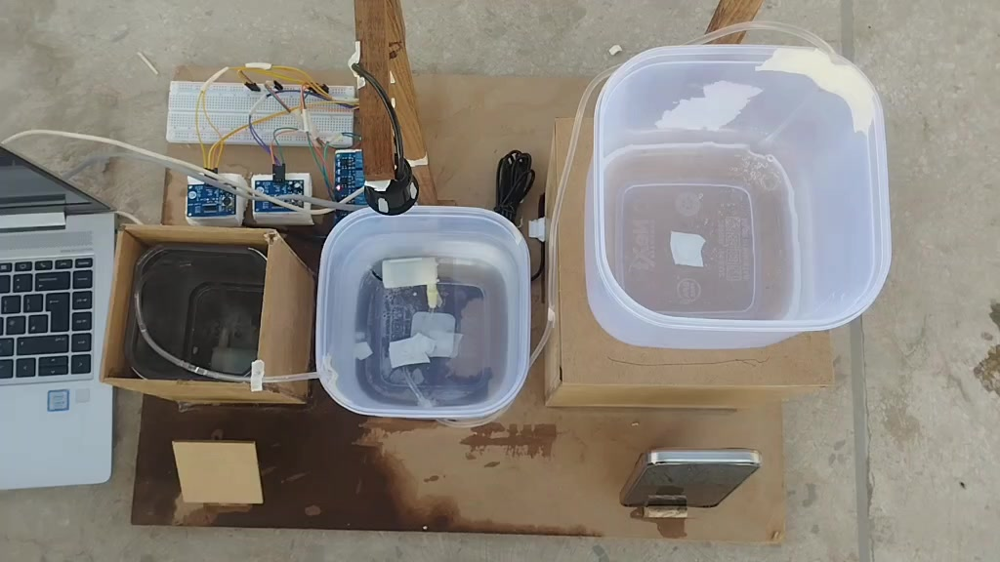
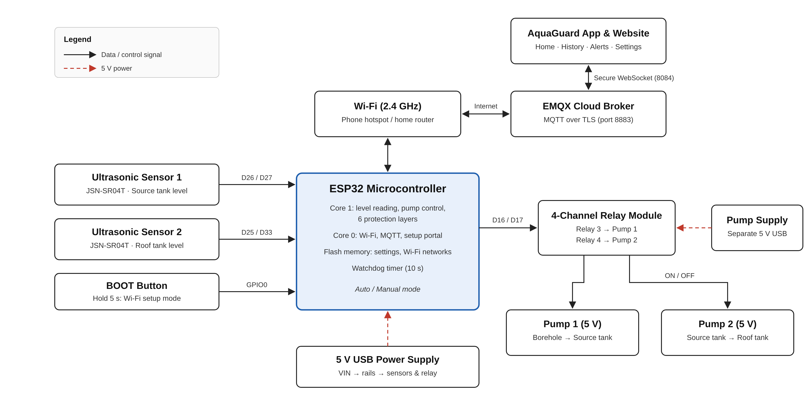

# AquaGuard – Smart Two-Tank Water Controller

**EEECi 2026 · TechForge** · Department of Electrical Engineering, COMSATS University Islamabad

AquaGuard is a low-cost IoT controller that runs a home's two water tanks and two pumps as one system.
An ESP32 measures both tank levels with waterproof ultrasonic sensors, switches the pumps through a relay
module, and connects to an EMQX cloud broker over encrypted MQTT, so the system can be watched and
controlled from a phone or a laptop.

## Features
- Automatic filling of the ground (source) tank and the roof tank
- Live water levels, pump control, history graphs and alerts in the web/Android app
- Six protection layers:
  1. **Source-empty lock** – Pump 2 is locked at 25% and released at 40% (Auto and Manual)
  2. **Dry-borehole detection** – Pump 1 stops if the level does not rise 2% in 30 s
  3. **Safety timer** – no pump runs longer than 5 minutes
  4. **Rest, retry and lockout** – rests 1 minute, locks out after 3 failed tries
  5. **Sensor-fault stop** – automatic pumping pauses if a sensor gives no echo for 10 s
  6. **Safe start and offline operation** – relays off at power-up, control continues without internet

## Repository layout
| Path | Contents |
|---|---|
| `firmware/AquaGuard/` | Main ESP32 firmware (Arduino C++) |
| `firmware/Sensor_Test/` | Simple sketch to check both ultrasonic sensors |
| `index.html` | Web app (HTML + JavaScript + MQTT.js), hosted at aquaguard-controller.netlify.app |
| `app/`, `build.gradle`, `gradle/` | Android app that wraps the web app |
| `.github/workflows/` | Automatic Android APK build |
| `docs/images/` | Block diagram, flowchart, state machine, results graph, photos |

## System design

## Hardware
| Component | Qty | Cost (Rs) |
|---|---|---|
| ESP32 DevKit (38-pin) | 1 | 1,210 |
| JSN-SR04T waterproof ultrasonic sensor | 2 | 1,600 |
| 4-channel 5 V relay module | 1 | 375 |
| 5 V submersible pump | 2 | 800 |
| Jumper wires (40-pack) | 1 | 290 |
| Breadboard, tubing, cable | – | ~700 |
| **Total** | | **≈ 4,975** |

### Wiring
| Part | ESP32 pin |
|---|---|
| Sensor 1 (source tank) TRIG / ECHO | D26 / D27 |
| Sensor 2 (roof tank) TRIG / ECHO | D25 / D33 |
| Relay IN3 (Pump 1, borehole) | D16 |
| Relay IN4 (Pump 2, roof) | D17 |
| Sensors and relay VCC / GND | 5 V (VIN) / GND |

## Getting started
1. Install the **Arduino IDE** and the **ESP32 board package** (Espressif).
2. Install the libraries **PubSubClient** (Nick O'Leary) and **ArduinoJson** (Benoit Blanchon).
3. Open `firmware/AquaGuard/AquaGuard.ino` and fill in your own EMQX address, username and password
   (lines 112–116). Wi-Fi can be typed on lines 89–90 or set from a phone through the
   `AquaGuard-Setup` hotspot.
4. Select **ESP32 Dev Module**, choose the COM port and click **Upload**.
5. Open the web app (or install the Android APK), go to **Settings → Cloud connection**, and enter the same EMQX details.

> Credentials are never stored in this repository or in the app. Each user enters them on their own device.

## MQTT topics
| Topic | Direction | Content |
|---|---|---|
| `wlc/<id>/status` | Device → app | Levels, pump states, alerts (retained) |
| `wlc/<id>/event` | Device → app | Alert messages |
| `wlc/<id>/avail` | Device → app | Online / offline (last will) |
| `wlc/<id>/config` | Device → app | Settings and schedules (retained) |
| `wlc/<id>/cmd` | App → device | On, off, mode, reset, settings |

## Live app
https://aquaguard-controller.netlify.app

## Team
M. Anees (093) · Hassan Abbas (064) · Hamayl Khan (109) · M. Abdullah (085)
Supervisor: Dr. Amir Rasheed

## License
MIT – see `LICENSE`.
